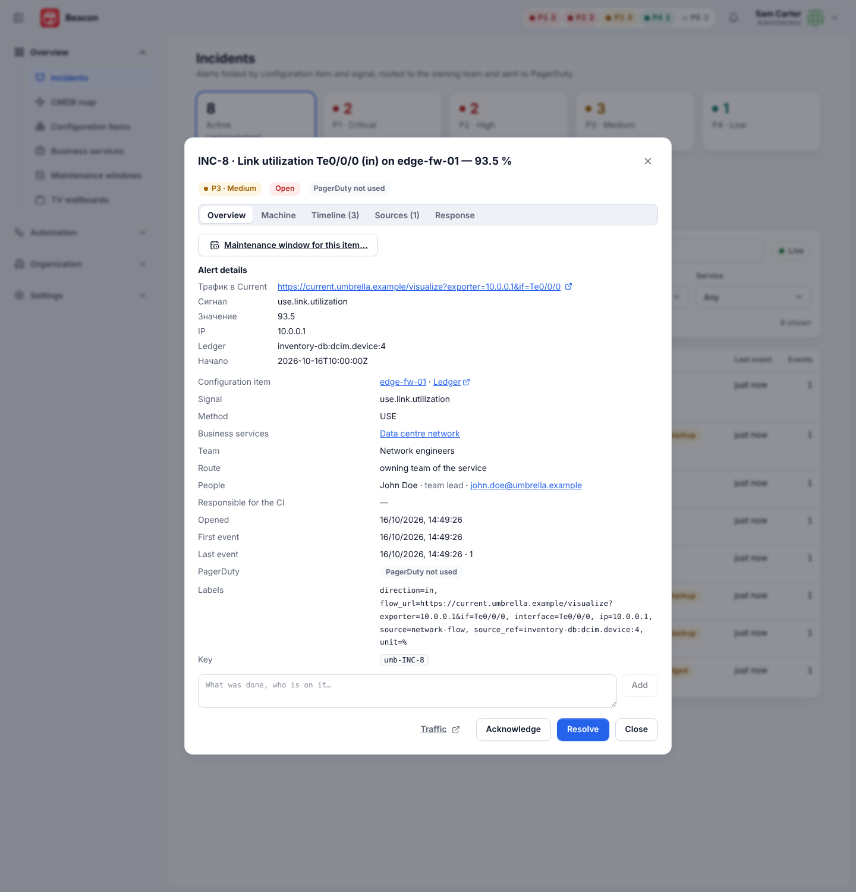
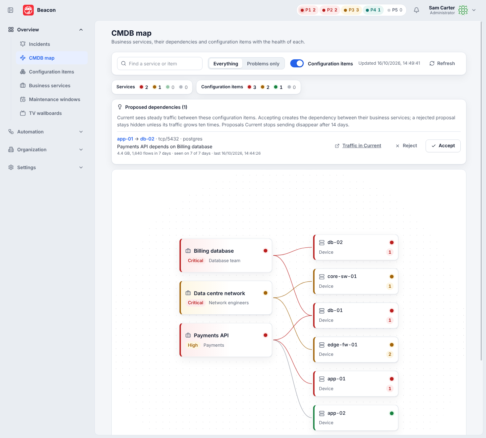

# Integration with Current

Current is a companion application for traffic analysis over NetFlow, IPFIX and sFlow (in the spirit of Akvorado and
ElastiFlow). The integration is two-way and optional:

- **Current → Beacon.** The Current detector sends traffic events (link utilization, DDoS, anomalies,
  silent exporters) to a connector built from the `network-flow` template; Beacon turns them into incidents and handles
  them as usual: collapsing, maintenance windows, route, PagerDuty, fallback notification.
- **Beacon → Current.** Incident and CI cards get a "Traffic" link to the Current console, filtered by the
  CI and with a time window around the incident.
- **Current → Beacon: visibility scopes.** Current asks Beacon which CIs and services a user may see and limits its
  queries for users whose Current role says so.
- **Current → Beacon: dependency proposals.** Current posts steady CI ↔ CI traffic as proposed dependencies between
  business services; people accept or reject them on the CMDB map.
- **Grafana.** The "CI traffic" dashboard over the Current ClickHouse tables, opened from an incident.

Current calls Beacon with an API token of a **service account** ([access.md](access.md#service-accounts-and-api-tokens)).
The cross-application contract is `docs/integrations.md` in the Current repository (§1, §3).

```mermaid
sequenceDiagram
  participant F as Current
  participant U as Beacon
  participant P as On-call engineer
  F->>U: POST /api/ingest/<address> (Bearer token), firing / resolved events
  U->>U: CI by source_ref, name or IP; incident, route, PagerDuty
  P->>U: incident card → "Traffic"
  U-->>P: 302 to <Current address>/go/incident?ci=…&ip=…&ref=…&from=…&to=…
```

## Current → Beacon: events

### Connecting

1. In Beacon: "Connectors" (or "Monitoring systems") → **Connect a source** → "Current" →
   "Connect". Beacon creates a Bearer token and a connector from the `network-flow` template, and publishes it.
2. Copy the intake address and the token (the token is shown once) into the Current settings (the "Beacon" section);
   Current stores the token in OpenBao.
3. The "Send a test event" button checks the path to an incident and shows the route.

The same via the API: `POST /api/connectors/quick` with the body `{"preset": "network-flow"}` (permissions `connectors:edit`,
`connectors:publish`, `credentials:edit`), see [connectors.md](connectors.md#quick-source-connection).

### Event format

A single object or an array of objects:

```json
{
  "id": "flow-7f3a1c",
  "status": "firing",
  "signal": "use.link.utilization",
  "method": "USE",
  "severity": "warning",
  "title": "Link utilization xe-0/0/1 on edge-01 — 93.5 %",
  "ci": "edge-01",
  "source_ref": "inventory-db:dcim.device:100",
  "ip": "10.0.0.1",
  "value": 93.5,
  "labels": {"interface": "xe-0/0/1", "direction": "in"},
  "links": {"flow": "https://flow.example.com/visualize?exporter=10.0.0.1&if=xe-0/0/1"},
  "starts_at": "2026-10-12T09:00:00Z",
  "ends_at": ""
}
```

| Current field | Beacon event field | Note |
| --- | --- | --- |
| `id` | external ID, deduplication key | resolved with the same `id` closes the firing event |
| `status` | status | `firing` or `resolved`; empty — firing |
| `signal` | signal | `use.link.utilization`, `use.link.commit`, `red.ddos.volumetric`, `red.ddos.syn`, `red.traffic.anomaly`, `red.traffic.drop`, `use.exporter.silent`, `sec.threat.contact` and others |
| `method` | RED / USE method | without the field — by the signal prefix `red.` / `use.`; otherwise "other" |
| `severity` | severity | `critical` (P1), `error` (P2), `warning` (P3), `low` (P4), `info` (P5) and synonyms; unknown — P3 |
| `title` | title | empty — the signal |
| `ci`, then `ip`, then `source_ref` | CI name in the event | see "How the CI is found" |
| `value` | value | |
| `labels` | labels | kept as is |
| `source_ref`, `ip`, `links.flow` | labels `source_ref`, `ip`, `flow_url` | plus the label `source=network-flow` |
| `links.flow`, `ip`, `source_ref`, `starts_at`, `ends_at` | incident fields | "Трафик в Current" (Traffic in Current), "IP", "Ledger", "Начало" (Start), "Окончание" (End) — the field names are fixed in the template in Russian; empty ones are not shown |

### How the CI is found

1. The `source_ref` label (from the `source_ref` field) matches the Ledger reference of exactly one CI — that CI
   is taken. CIs loaded from Ledger have the reference ([ledger.md](ledger.md)).
2. Otherwise — the usual name lookup by the `ci` field (ID, name, short name, IP, DNS name, aliases, manual
   host links).
3. The name found no CI (or found several) — the `ip` label, if it is the IP address of exactly one CI.

Rules 1 and 3 work for any connector that sets the `source_ref` and `ip` labels. An incident without
a CI waits for one, like the others: once the CI appears (a Ledger load, creation from the card), the incident is
bound to it.

## Beacon → Current: the "Traffic" link

"Settings → Alerting" → the **Current address** card (next to Grafana): the public address of Current,
for example `https://flow.example.com`. As long as the address is not set, there are no links anywhere.

With the address:

- incident card — the "Traffic" button to `/go/incidents/{id}/flow`;
- CI card — the "Traffic" row to `/go/cis/{id}/flow`;
- PagerDuty (the "Traffic in Current" link) and the fallback notification (e-mail, Telegram, Teams, Zoom —
  the "Traffic" link) — via the public Beacon address, like the Grafana link.

Beacon answers with a redirect to the Current console:

```
<Current address>/go/incident?ci=<CI name>&ip=<IP>&ref=<source_ref>&from=<RFC 3339>&to=<RFC 3339>
```

| Parameter | Incident | CI |
| --- | --- | --- |
| `ci` | CI name from the catalog; without a CI — the name from the event | CI name |
| `ip` | the first address of the CI; without it — the `ip` label of the event | the first address of the CI |
| `ref` | the Ledger reference of the CI; without it — the `source_ref` label of the event | the Ledger reference of the CI |
| `from` | 30 minutes before the incident was opened | an hour ago |
| `to` | now; for a resolved one — 10 minutes after resolution (no later than the current moment) | now |

Empty `ip` and `ref` are not passed. Access works like the Grafana link: a signed-in user with the
`incidents:view` permission and the incident within their visibility scope (for a CI — the `cis:view` permission) goes to Current,
others go to the incident (`/incidents?id=…`) or the CI (`/cis?id=…`) in Beacon. A click from PagerDuty, e-mail
or a messenger arrives without the session cookie (SameSite=Strict): Beacon returns a short page
that repeats the request from its own address.

## Current → Beacon: visibility scopes

1. In Beacon: **Settings → Service accounts** — create a role with `integrations.flow:read` and `cmdb:propose`
   (Roles page; the "Current integration" and "CMDB map" groups), then a service account with this role, and issue
   a token. Copy the token (shown once) into the Current settings ("Beacon" section); Current keeps it in OpenBao.
2. Current asks for the scope of a signed-in user and caches it for 60 s:

```
GET /api/integrations/flow/scope?username=<login>
Authorization: Bearer umb_…
```

```json
{"username": "ivanov", "known": true, "mode": "teams",
 "cis": [{"id": "CI-12", "name": "app-01", "source_refs": ["inventory-db:dcim.device:100"], "ips": ["10.0.0.5"]}],
 "services": [{"id": "SVC-3", "name": "Billing"}]}
```

The user is found by login, ignoring case (LDAP and Entra ID logins are the same in both applications). The scope is
the one of [access.md](access.md#visibility-scope):

| Beacon | `mode` | `cis`, `services` |
| --- | --- | --- |
| administrator, or "All services" | `all` | empty: everything |
| "Services of my teams" | `teams` | the services the user's teams own or support and every CI bound to one of them |
| "Chosen services" | `selected` | the chosen services and their CIs |
| locked account | `selected` | empty: nothing |
| unknown login | — | `{"known": false}` |

Retired services and their CIs are left out. `source_refs` holds the Ledger reference of a CI (Current writes it to
`SrcCI` / `DstCI`), `ips` its addresses. Without `username` — 400 `username_required`.

## Current → Beacon: dependency proposals

Current finds steady traffic between two CIs (both ends resolved; enough flows on enough of the last 7 days; the server
port detected) and posts it daily and on demand:

```
POST /api/cmdb/proposals
Authorization: Bearer umb_…
```

```json
{"source": "umbrella-flow", "generated_at": "2026-10-12T10:00:00Z",
 "proposals": [{
   "key": "flow:inventory-db:dcim.device:100->inventory-db:dcim.device:200:tcp/5432",
   "from": {"source_ref": "inventory-db:dcim.device:100", "name": "app-01", "ip": "10.0.0.5"},
   "to":   {"source_ref": "inventory-db:dcim.device:200", "name": "db-01", "ip": "10.0.1.9"},
   "type": "depends_on",
   "evidence": {"protocol": "tcp", "port": 5432, "app": "postgres", "bytes_7d": 123456789, "flows_7d": 4200,
                "days_seen": 7, "first_seen": "…", "last_seen": "…", "flow_url": "https://flow.corp/visualize?q=…"}
 }]}
```

→ `{"accepted": 1, "updated": 0, "ignored": 0}`.

- Each end is resolved to a CI the way events are ([How the CI is found](#how-the-ci-is-found)): the Ledger
  reference, then the name (with aliases, short names, IPs, DNS names and manual host links), then the IP address. A
  proposal whose end matches no CI (or several), whose ends are the same CI, without a `key` or with another `type` is
  **ignored** and not stored. Unknown fields are allowed. Up to 1000 proposals per request.
- Proposals are stored in the state snapshot, keyed by `key`: a new key is **accepted**, a known one **updated** (ends
  and evidence replaced, refreshed). Up to 5000 proposals are kept; proposals not refreshed for **14 days expire**.
- The implied dependency: every active or planned business service of the `from` CI depends on every such service of
  the `to` CI (never a service on itself).
- **CMDB map → Proposed dependencies** (`cmdb:view`): pending proposals, the most traffic first, with the ends (a click
  selects the CI on the map), protocol / port / application, the volume and flows over 7 days, the days seen, the
  last time seen, the implied service dependencies (those already set are marked) and a "Traffic in Current" link.
  **Accept** (`services:edit`) creates the missing dependencies with the checks of a service edit (no cycles, error
  `dependency_cycle`; without services on both ends — `proposal_unresolved`); a later refresh keeps it accepted.
  **Reject** (`services:edit`) hides the proposal for this key until its `bytes_7d` or `flows_7d` grows **10 times**
  over the values at rejection; then it is pending again.
- Audit log: `cmdb.proposals` (each batch with the counts), `cmdb.proposal.accepted`, `cmdb.proposal.rejected`.

## Grafana: CI traffic

`deploy/grafana/flow-ci-traffic.json` — the "CI traffic" dashboard (uid `flow-ci-traffic`) on the Current ClickHouse
datasource (`grafana-clickhouse-datasource`, uid `flow-clickhouse`) with the variables `ci`, `ci_id`, `ip`, `ref`:
traffic in / out of the CI (`SrcCI` / `DstCI` = `ref` or `SrcAddr` / `DstAddr` = `ip`, else the host name `ci`), top
talkers, top ports and applications, top interfaces, a long-range panel over `flows_1m` / `flows_5m` / `flows_1h`, and,
for a CI that exports flows itself (a router with an interface utilization incident), the traffic it carried per
interface (`ExporterRef` = `ref` or `ExporterAddress` = `ip`). The file is identical in both repositories. Setting it up and the
environment of the datasource: [deploy/grafana/README.md](../../deploy/grafana/README.md#current-ci-traffic).
Set its address in **Settings → Alerting → Grafana**: the incident link fills `ci`, `ci_id`, `ip` (the first
address of the CI, else the `ip` label of the events) and `ref` (the Ledger reference of the CI, else the
`source_ref` label), next to the variables of the incident dashboard.

## Verified end to end

On one host with Current, Ledger, OpenBao and PostgreSQL, wired only through the APIs above: the
`network-flow` quick connect received Current's link-utilization events, which opened an incident on the exporter's CI
(found by the Ledger `source_ref` of a CI loaded from Ledger) and resolved it when the condition cleared;
the incident's "Traffic" link (`/go/incidents/{id}/flow`) and the CI's (`/go/cis/{id}/flow`) opened Current filtered on
the CI; a service account with `integrations.flow:read` and `cmdb:propose` served the scope of a user with one chosen
service (Current showed that user only the flows of that service's CI) and delivered a dependency proposal whose implied
service dependency appears on the CMDB map.

The two screenshots below were retaken after the rename on demo data (the same event and proposal formats, sent to
Beacon with fakes of Keystone and Ledger):





## API

| Method | Path | Permission | Purpose |
| --- | --- | --- | --- |
| GET | `/api/flow` | `settings.alerting:view` | `{url, updated_at, updated_by}` |
| PUT | `/api/flow` | `settings.alerting:edit` | `{url}`: http or https without parameters, a trailing `/` is dropped; empty — turn the links off; error `url_invalid` |
| GET | `/go/incidents/{id}/flow` | sign-in + `incidents:view` | redirect to the incident's traffic |
| GET | `/go/cis/{id}/flow` | sign-in + `cis:view` | redirect to the CI's traffic for the last hour |
| POST | `/api/connectors/quick` `{"preset":"network-flow"}` | `connectors:edit`, `connectors:publish`, `credentials:edit` | quick connection of Current |
| GET | `/api/integrations/flow/scope?username=` | `integrations.flow:read` | visibility scope of a user for Current |
| POST | `/api/cmdb/proposals` | `cmdb:propose` | dependency proposals from Current |
| GET | `/api/cmdb/proposals` | `cmdb:view` | pending proposals with the implied dependencies; `?status=all` also accepted and rejected ones |
| POST | `/api/cmdb/proposals/accept` `{"key"}` | `services:edit` | create the implied service dependencies |
| POST | `/api/cmdb/proposals/reject` `{"key"}` | `services:edit` | hide the proposal until its evidence grows 10× |

The responses of `GET /api/incidents/{id}` and of CIs (`GET /api/cis`, `GET /api/cis/{id}`) contain `flow_url` (the
`/go/…/flow` path) when the Current address is set. A change of the address is written to the audit log (`settings.flow`).
