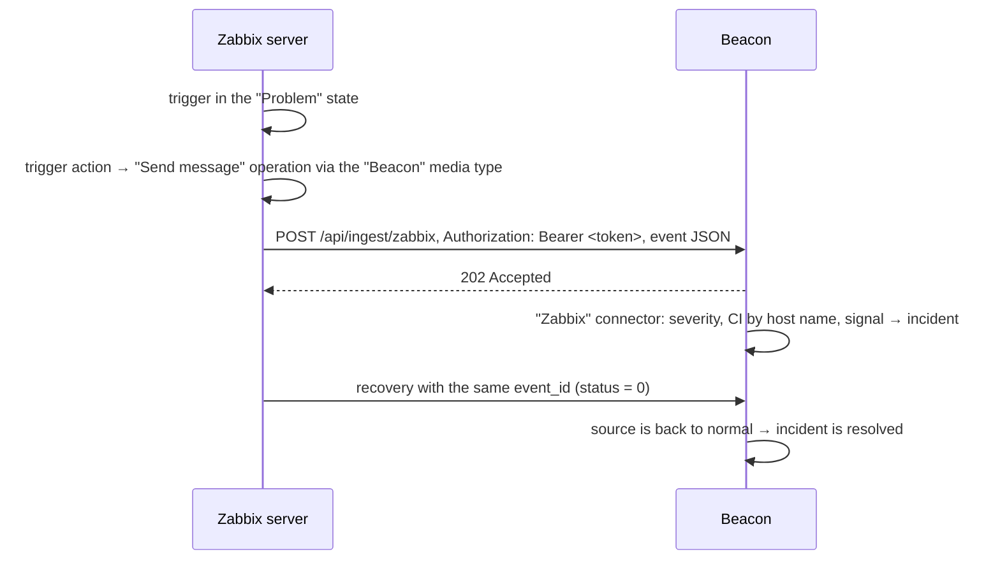

# Receiving incidents from Zabbix

What to set up, and how, so that Zabbix problems reach Beacon and open incidents, and
recoveries close them.

## How it works

Zabbix sends events with a **Webhook-type media type** (a JavaScript script inside
Zabbix). Beacon receives them with a **connector** built from the "Zabbix (webhook media
type)" template and checks the **Bearer token**. Beacon itself does not poll Zabbix for problems:
delivery is started by a Zabbix action.

## Prerequisites

| What | Why |
|---|---|
| Zabbix 7.0 or newer, including 8.0 | the media type file is exported in the 7.0 format, Zabbix 8.0 imports it without changes. On 6.0–6.4 the media type is created by hand (see "Zabbix 6.x") |
| Access from the **Zabbix server** (or the proxy, if it sends the alerts) to the Beacon address over HTTP(S) | the script runs on the Zabbix server, not in the browser |
| The public Beacon address in "Settings → Alerting → Beacon address" | Beacon uses it to build the intake address in the instructions and the file |
| Permissions in Beacon: `connectors:edit`, `connectors:publish`, `credentials:edit` (and `monitoring:edit` to connect from "Monitoring systems") | to create the token and the connector |
| Administrator rights in Zabbix | importing the media type, the user, the action |

If Beacon is behind HTTPS with a self-signed certificate, the Zabbix server must trust that
certificate (the system CA store on the Zabbix server), otherwise sending fails with a TLS error.

## Step 1. Beacon: token and connector

The quick way (recommended):

1. **Automation → Monitoring systems** → the card of your Zabbix → the **Alert
   intake** tab → **Connect the alert intake**. Or **Automation → Connectors → Connect a
   source → Zabbix**.
2. Beacon creates a Bearer token "Intake token: …" and a "Zabbix" connector from the template, and
   publishes it right away.
3. The response contains the intake address (`https://umbrella.example.com/api/ingest/zabbix`), the token and the file
   **`beacon-mediatype.yaml` with the address and token already filled in**. Download the file immediately:
   the token is shown **once**; after that it is stored only in OpenBao.

By hand (if you need your own connector):

1. **Automation → Credentials** → create a **Bearer token**, copy the value.
2. **Connectors** → create a connector from the "Zabbix (webhook media type)" template, in the
   webhook node choose this token, **Publish**. The intake address is `/api/ingest/<slug>`,
   `/api/ingest/zabbix` by default.
3. Take the file [`deploy/zabbix/beacon-mediatype.yaml`](../../deploy/zabbix/beacon-mediatype.yaml)
   and after importing it fill in `url` and `token` (step 2).

## Step 2. Zabbix: the "Beacon" media type

1. **Alerts → Media types → Import** → the `beacon-mediatype.yaml` file → **Import**.
2. Open the **Beacon** media type and check the parameters:

   | Parameter | Value | What it is |
   |---|---|---|
   | `url` | the intake address from step 1 | where to send |
   | `token` | the token from step 1 | the Bearer token; a value starting with `<` is treated as not set |
   | `event_id` | `{EVENT.ID}` | the recovery finds the same alert by it |
   | `host` | `{HOST.HOST}` | the technical host name — the CI is looked up by it |
   | `host_group` | `{TRIGGER.HOSTGROUP.NAME}` | the host's groups, sent as the `host_group` label |
   | `trigger` | `{EVENT.NAME}` | the incident title |
   | `item_key` | `{ITEM.KEY1}` | the signal: events are collapsed into one incident by the "CI + signal" pair |
   | `severity` | `{EVENT.NSEVERITY}` | severity 0–5 |
   | `status` | `{EVENT.VALUE}` | 1 — problem, 0 — recovery |
   | `value` | `{ITEM.LASTVALUE1}` | the last value of the item |

3. The media type must be **Enabled**. The default timeout is 10 s.
4. The **Test** button in the list of media types: fill in `url`, `token` and, for example, `event_id=test-1`,
   `host=<host name>`, `trigger=Test`, `severity=3`, `status=1`. The `OK` response means Beacon
   accepted the event. Don't forget to close it with a second test with `status=0` and the same `event_id`.

## Step 3. Zabbix: the recipient

An action sends a message to a user, so the "Beacon" media type must be assigned to a
user (preferably a separate service user, for example `umbrella`, without the right to sign in to the
interface):

1. **Users → Users** → the user → the **Media** tab → **Add**.
2. Type — **Beacon**, "Send to" — any non-empty value (for example `umbrella`),
   "When active" — `1-7,00:00-24:00`, tick **all severities**. The severity filter is better
   set in the action conditions (step 4).
3. The user must have **read permission on the host groups** whose events you want to
   send (via a user group). Otherwise Zabbix will not send them messages for those
   hosts.

## Step 4. Zabbix: the trigger action

**Alerts → Actions → Trigger actions → Create action**:

1. **Action**: name `Beacon`. Conditions (optional):
   - "Trigger severity" **is greater than or equals** "Warning" — do not send
     informational events;
   - "Problem is suppressed" — **No**, if you track maintenance in Zabbix. If you keep maintenance
     windows in Beacon, this condition is not needed: Beacon itself holds such incidents
     and does not send them to PagerDuty;
   - "Host group" — restrict to the groups you need.
2. **Operations → Operations**: "Send message", the user (or group) from step 3,
   **Send only to** — `Beacon`. Steps 1–1, default duration: one
   message per problem is enough, no repeats are needed.
3. **Recovery operations**: "Send message" to the same user via `Beacon`.
   **Without this operation, incidents in Beacon will not close by themselves.**
4. **Update operations** are not needed: Beacon does not use acknowledgements and comments from
   Zabbix.
5. **Add**; the action must be **Enabled**.

## How Beacon parses an event

| Zabbix | Beacon |
|---|---|
| Severity 5 "Disaster" | P1 · Critical |
| 4 "High" | P2 · High |
| 3 "Average" | P3 · Medium |
| 2 "Warning" | P4 · Low |
| 1 "Information", 0 "Not classified" | P5 · Informational |
| `{HOST.HOST}` | CI: first hosts with a manual link in "Monitoring systems", then the CI name, short name, IP and DNS |
| `{ITEM.KEY1}` (if empty — the trigger name) | the incident signal |
| `{EVENT.ID}` | the external event ID: a recovery with the same ID closes the source |
| `{TRIGGER.HOSTGROUP.NAME}` | the `host_group` label; the `source=zabbix` label |

The mapping of severities and fields can be changed in the connector editor (the `map.severity`
and `map.event` nodes) and published as a new version — Zabbix does not need to be touched for that.

The incident gets the CI route (business services, team, people) and goes to PagerDuty and
the fallback notification under the common rules. When all sources of the incident have sent a
recovery, it resolves itself ("every source is back to normal").

To make sure Zabbix hosts find their CIs, add Zabbix in **Automation → Monitoring
systems** (the web interface address and a Zabbix API token), load the hosts and link
the unmatched ones to CIs by hand or create CIs from them ([monitoring-hosts.md](monitoring-hosts.md)).
Without this, an incident for an unknown host still opens, but without a CI and a route.

## Verification

1. In Beacon, on the system's **Alert intake** tab (or in the connector editor) —
   **Send a test event**: checks the connector and the route without involving Zabbix.
   The test incident is not sent to PagerDuty and resolves itself after 5 minutes.
2. In Zabbix — the media type **Test** (step 2) or a real trigger: for example, an item
   of type "Zabbix trapper" and `zabbix_sender -z <zabbix> -s <host> -k <key> -o <value>`.
3. The result:
   - in Beacon: **Incidents** — a new incident; in the connector, the **Requests**,
     **Events**, **Failures** tabs;
   - in Zabbix: **Reports → Action log** — status "Sent" or the error text.

## Troubleshooting

| Symptom | Cause and what to do |
|---|---|
| `Beacon answered 401` in the Zabbix action log | wrong or unset `token`; create a new token and update the parameter |
| `Beacon answered 404` | the connector is not published, or the slug in `url` is wrong |
| `Beacon answered 403` | the connector restricts intake networks — add the Zabbix server address |
| `Beacon answered 503` | the connector is stopped or failed to publish, or Beacon is not ready to receive (PostgreSQL, OpenBao) — "Settings → System status" |
| `Beacon answered 413` / `429` | the body is too large or the connector's rate limit is exceeded |
| `Couldn't connect`, `timeout`, TLS error | the Zabbix server cannot reach Beacon: DNS, firewall, proxy, certificate |
| The action log is empty | the action is disabled, the conditions did not match, the user has no "Beacon" media or no permissions on the host group |
| There is an incident, but without a CI | the host name did not match a CI — link the host in "Monitoring systems" |
| Incidents do not close | there is no recovery operation in the action |
| The request arrived, but there is no event | the connector's **Failures** tab: what is wrong with the body; after fixing — reprocessing |

## Zabbix 6.x

Importing a 7.0-format file into Zabbix 6.x will fail. Create the media type by hand:
**Administration → Media types → Create media type**, type **Webhook**, name `Beacon`,
the parameters from the step 2 table, the script — the contents of the `script` field from
[`beacon-mediatype.yaml`](../../deploy/zabbix/beacon-mediatype.yaml), timeout `10s`,
message templates for "Problem" and "Problem recovery" (any text). The other steps
are the same; in 6.0 the menu sections are called "Configuration → Actions" and "Administration →
Users".
