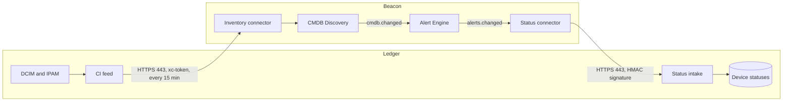

# Integration with Ledger (architecture)

[Ledger](https://onedev.evcsbrw.ru/Monitoring/Ledger) is a NetBox-style data-centre inventory application: sites, racks,
devices, interfaces, cables, IP addresses and VLANs. Beacon and Ledger exchange data in both directions; what is
described here is the same for the MVP (flow P-11) and the target architecture (flow P-13). The integration needs no new
containers: both sides are built from blocks of the low-code builder.

The implemented, optional integration in the application is documented in [app/docs/ledger.md](../app/docs/ledger.md).

| Direction | What is sent | How |
| --- | --- | --- |
| Ledger → Beacon | Sites, racks and devices as CIs of the CMDB map: names, IP addresses, DNS names, serial numbers, "located in" relations (device → rack → site) and "connected to" (by cables) | The CMDB Discovery inventory connector reads the CI feed `GET /api/v1/integrations/{id}/umbrella/ci` with an API token every 15 minutes |
| Beacon → Ledger | Alert changes on devices: status, severity, title, signal, links to the incident and the Grafana context | The Connector Runtime status connector subscribes to alerts.changed and sends `POST /api/v1/integrations/{id}/umbrella/alerts` signed with HMAC |



The draw.io diagrams of the architecture sets (kept outside this repository) do not show this integration yet; the next
generator change adds Ledger to the context, flow and integration diagrams.

## Roles of the systems

- **Ledger is the master of physical CIs.** Beacon does not keep records of equipment, IP addresses and cables;
  it takes them from Ledger as a trusted source: additions apply immediately, removals and conflicts go to map
  review.
- **Beacon is the master of monitoring state.** Ledger does not compute alerts itself; it shows on the device
  card and in device lists what Beacon sent.
- Logical CIs (services, pods, cloud groups) are still built from monitoring data; a physical device from Ledger
  and a host from a monitoring system are glued together by hostname, FQDN and IP.

## Setup

1. In Ledger the integration owner creates it: `POST /api/v1/integrations` with the body
   `{"kind":"umbrella","title":"Beacon","umbrellaUrl":"https://umbrella.corp","inventoryUrl":"https://inventory.corp"}`.
   The response contains `integration.id` and the signing secret `secret`; the secret is shown once.
2. In Ledger a read-only service user and its API token are created (`POST /api/v1/tokens`). The feed contains what
   this user can see through the DCIM and IPAM API.
3. The token and the secret are put into OpenBao; connectors hold only references to them.
4. The **inventory connector** is built in Beacon's builder:
   - "schedule" trigger, 15 minutes;
   - HTTP REST `GET {inventoryUrl}/api/v1/integrations/{id}/umbrella/ci?offset=‹offset›&limit=1000`, "token"
     authorization in the `xc-token` header;
   - paging by `offset` until `next_offset` is null;
   - mapping of each `items[]` element to an inventory object: `source_ref` → source_refs, `type`, `name`, `identities`,
     `logical_group`, `status`, `relations` (type, direction, `target_ref`), `monitored` and `url` → CI attributes;
   - output "inventory object"; in the discovery rules the Ledger source is marked as trusted.
5. The **status connector** is built:
   - "queue subscription" trigger on alerts.changed;
   - filter: the alert's CI has a source_ref with the `inventory-db:` prefix, or the CI is of type "host";
   - body template per the contract below;
   - HTTP REST `POST {inventoryUrl}/api/v1/integrations/{id}/umbrella/alerts`, "HMAC request signature" authorization;
   - retry with backoff on 5xx responses and timeouts; a 4xx response is written to the connector log without retry.
6. Suppression rule: alerts on CIs with the attribute `monitored = false` (planned, offline, inventory, decommissioning
   devices) are not sent to PagerDuty or the fallback channels, but are visible on the incidents dashboard.
7. A link to the device card in Ledger from the `url` attribute is added to the event template.

## CI feed

`GET /api/v1/integrations/{id}/umbrella/ci?offset=0&limit=1000` returns a full snapshot; CMDB Discovery computes the
difference between snapshots, so no change cursor is needed.

```json
{
  "source": "inventory-db", "integration_id": "int_…", "generated_at": "2026-10-08T14:00:00.000Z",
  "count": 4, "offset": 0, "next_offset": null,
  "items": [{
    "source_ref": "inventory-db:dcim.device:100",
    "type": "device", "name": "App-01", "status": "active", "monitored": true,
    "identities": { "hostname": "app-01", "fqdn": ["app-01.corp.example"], "ip": ["10.0.0.5"], "serial": "SN100" },
    "logical_group": null,
    "attributes": { "role": "Server", "manufacturer": "Dell", "model": "R650", "site": "DC1", "rack": "R01", "tags": ["prod"] },
    "relations": [
      { "type": "located_in", "direction": "out", "target_ref": "inventory-db:dcim.rack:10" },
      { "type": "connected_to", "direction": "out", "target_ref": "inventory-db:dcim.device:101", "via": "cable 5" }
    ],
    "url": "https://inventory.corp/dcim/devices/100",
    "last_updated": "2026-10-01T10:00:00Z"
  }]
}
```

| Field | Meaning |
| --- | --- |
| source_ref | stable reference `inventory-db:‹type›:‹id›`, type is dcim.site, dcim.rack or dcim.device |
| type | site, rack, device |
| identities | hostname (device name in lower case), fqdn (DNS names of its IP addresses), ip (interface addresses, primary and OOB), serial, asset_tag |
| logical_group | the device's virtual chassis or cluster; used for gluing, like a cloud group |
| status, monitored | NetBox lifecycle status; monitored = false for planned, offline, inventory, decommissioning |
| relations | located_in: device → rack (or site without a rack), rack → site; connected_to: device → device at the other end of a cable |

## Alert statuses

`POST /api/v1/integrations/{id}/umbrella/alerts`; the body is one event or an array of up to 500.

```json
{
  "alert_id": "8f1c…", "status": "open", "severity": "critical",
  "title": "Host down: app-01", "signal": "use.host.availability",
  "ci": { "source_refs": ["inventory-db:dcim.device:100"], "name": "app-01",
          "identities": { "hostname": "app-01", "fqdn": "app-01.corp.example", "ip": "10.0.0.5" } },
  "links": { "incident": "https://umbrella.corp/incidents/8f1c…", "grafana": "https://umbrella.corp/go/incidents/8f1c…/grafana" },
  "updated_at": "2026-10-08T14:00:00Z"
}
```

- `status`: open, acknowledged, resolved, closed; `severity`: critical, error, warning, info — the same values as an
  Beacon alert. In the target architecture `links.incident` points to the incident the alert belongs to.
- **Signature.** Headers `x-umbrella-timestamp: ‹unix time in seconds›` and
  `x-umbrella-signature: v1=‹hex HMAC-SHA256(secret, "‹timestamp›.‹request body›")›`. Requests older than 5 minutes are
  rejected. During secret rotation the header may carry two comma-separated signatures.
- **Device matching.** First by the `inventory-db:` source_ref; without it, by hostname, FQDN and its short name, CI
  name and IP, case-insensitively. Alerts without a match are visible to the integration owner in Ledger
  (`GET /api/v1/integrations/{id}/umbrella/unmatched`) so names or addresses can be fixed.
- **Idempotency.** A repeat with the same alert_id overwrites the state; an update with an older `updated_at` than the
  stored one is dropped, so retries and out-of-order delivery are safe.
- **Responses.** 202 with the matching result for each event; 400 — the body does not follow the contract; 401 — wrong
  or stale signature, unknown or disabled integration.

In Ledger a device's status is the worst severity among open and acknowledged alerts, or ok. It is shown as a
coloured chip in lists and in the device side panel, in the same colours as Beacon's legend, with the list of alerts
and links to the incident and Grafana.

## Security

| Risk | Measure |
| --- | --- |
| Spoofed statuses | HMAC signature with a timestamp, 5-minute window; one 401 answer for an unknown or disabled integration and a wrong signature |
| Ledger token leak | read-only service-user token, in OpenBao; rotation in Ledger without republishing the connector |
| Signing secret leak | secret in OpenBao on Beacon's side and encrypted (AES-256-GCM) on Ledger's side; rotation through `POST /api/v1/integrations/{id}/rotate-secret` |
| Extra data in Ledger | the status connector sends only the contract fields: title, signal, severity, links; raw events and labels are not sent |

## Network access

| From | To | Port / protocol |
| --- | --- | --- |
| CMDB Discovery (inventory connector), Connector Runtime (status connector) | Ledger REST API (internal network) | 443 HTTPS |
